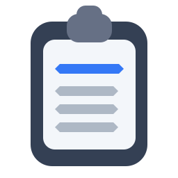
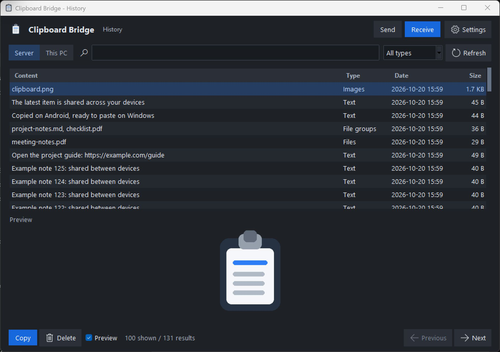
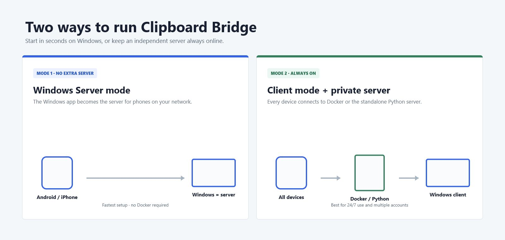
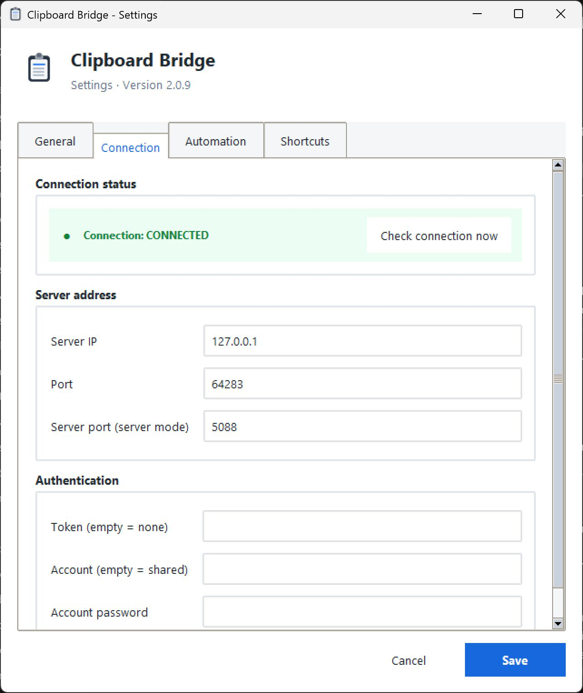
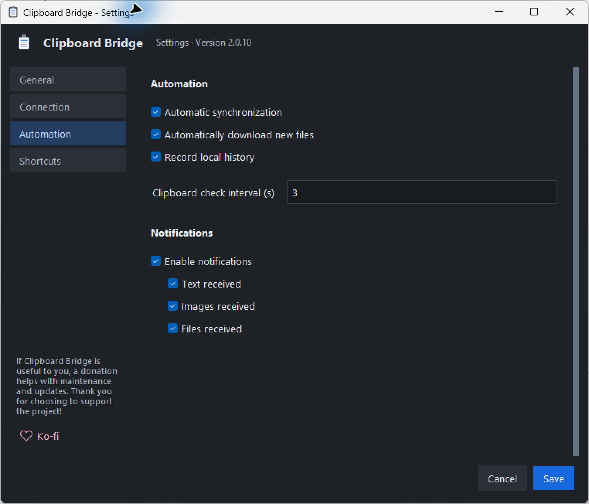

#  Clipboard Bridge

**Copia su un dispositivo. Usa il contenuto su un altro.**

Condividi testo, link, foto e file tra **Windows, Android, iPhone e iPad**.
Ad esempio, invia una foto dal telefono al PC oppure copia un link su Windows
e ricevilo sul telefono. Anche il Mac può usare lo stesso flusso tramite Comandi Rapidi.

Usa un server di casa sempre acceso per l'esperienza completa, **oppure lascia che
l'app Windows faccia da server se non ne possiedi uno**. I dispositivi si collegano
tramite rete locale o VPN privata. Un account Clipboard Bridge è opzionale.

[English](README.md) | **Italiano**

[Sito web](https://mattboxx.github.io/Clipboard-Bridge/) |
[Download](#download) | [Da dove iniziare](#da-dove-iniziare) |
[Guida completa](GUIDE.md) | [Sviluppatori](#sviluppatori)

[](https://github.com/Mattboxx/Clipboard-Bridge/actions/workflows/validate.yml)
[](LICENSE)

## Scegli la configurazione

Ogni dispositivo si collega a un unico punto che conserva la clipboard condivisa.
Scegli dove farlo funzionare:

| | **Server indipendente: esperienza completa** | **Modalità Server Windows: nessun hardware aggiuntivo** |
|---|---|---|
| Dove funziona | NAS, home server, Raspberry Pi o host Docker/Python | Nell'app Windows stessa |
| Perché sceglierlo? | Disponibile anche con il PC Windows spento | Collegamento telefono-PC più rapido da configurare |
| Testo, foto, file e cronologia condivisi | Sì | Sì |
| Pagina web e account utente separati | Sì | No |
| Cosa deve restare acceso | Il server | Il PC Windows con l'app avviata |
| Impostazione Windows | **Modalità Client** | **Modalità Server** |

Il server indipendente migliora l'uso quotidiano: clipboard sempre disponibile,
accesso dal browser e account isolati. **Non è obbligatorio:** la Modalità Server
Windows gestisce gli stessi contenuti senza Docker o un computer separato.

## Download

**Versioni attuali:** Windows 2.0.14 | Android 1.0.0-beta.10 | Server 1.0.7

| Il tuo dispositivo | Download pronti all'uso |
|---|---|
| **Windows 10/11, Intel o AMD (x64)** | [Installer](https://github.com/Mattboxx/Clipboard-Bridge/releases/download/2.0.14/Clipboard.Bridge_windows_client_and_server_setup_x64_V2.0.14.exe) oppure [EXE portable](https://github.com/Mattboxx/Clipboard-Bridge/releases/download/2.0.14/Clipboard.Bridge.Portable.Windows.x64.V2.0.14.exe) |
| **Windows 11 ARM, ad esempio PC Snapdragon** | [Installer ARM64 nativo](https://github.com/Mattboxx/Clipboard-Bridge/releases/download/2.0.14/Clipboard.Bridge_windows_client_and_server_setup_arm64_V2.0.14.exe) oppure [EXE portable ARM64 nativo](https://github.com/Mattboxx/Clipboard-Bridge/releases/download/2.0.14/Clipboard.Bridge.Portable.Windows.arm64.V2.0.14.exe) |
| **Android 10 o successivo** | [APK Android](https://github.com/Mattboxx/Clipboard-Bridge/releases/download/2.0.14/Clipboard.Bridge.Android.universal.V1.0.0-beta.10.apk), attualmente una beta pubblica |
| **iPhone e iPad** | [Comando per inviare](https://github.com/Mattboxx/Clipboard-Bridge/releases/download/2.0.14/iPhone.Load.Clipboard.shortcut) e [comando per ricevere](https://github.com/Mattboxx/Clipboard-Bridge/releases/download/2.0.14/iPhone.Download.Clipboard.shortcut) |
| **Mac** | [Guida ai Comandi Rapidi](GUIDE.md#mac-compatibility); nessuna app Mac nativa |
| **NAS o home server** | [Installazione dagli store](https://github.com/Mattboxx/Clipboard-Bridge-AppStore#readme) oppure [configurazione Docker](#server-indipendente) |

L'installer è l'opzione Windows più semplice. L'EXE portable non richiede installazione.
Entrambi salvano impostazioni e cronologia nella cartella dell'utente e le mantengono
negli aggiornamenti. Per identificare il processore apri **Impostazioni > Sistema >
Informazioni > Tipo sistema**. Chiudi l'app prima di passare da x64 ad ARM64:
le due architetture condividono le impostazioni.

> **Sicurezza Windows:** installer e portable non sono ancora firmati digitalmente.
> Defender o Smart App Control potrebbero bloccarli. Leggi [CODE_SIGNING.md](CODE_SIGNING.md);
> non disattivare la protezione Windows per aggirare un avviso.

File, checksum e note sono nella [release 2.0.14](https://github.com/Mattboxx/Clipboard-Bridge/releases/tag/2.0.14).
Sono incluse anteprime immagini/PDF e versioni ARM64 native. Le modifiche complete
sono nel [CHANGELOG.md](CHANGELOG.md); Android e server hanno versioni indipendenti.

## Da dove iniziare

**Prima controlla la rete:** i dispositivi devono raggiungere il server tramite
la stessa Wi-Fi/LAN attendibile oppure una VPN privata. La sola rete mobile non
raggiunge un IP della LAN di casa. Vedi [Rete e sicurezza](#rete-e-sicurezza) per l'uso remoto.

### Senza un server di casa

1. Installa o apri l'app Windows.
2. Apri **Impostazioni > Generale** e seleziona **Modalità Server**.
3. Mantieni la porta `5088`, se non è già occupata, e consenti l'app nel firewall
   Windows sulla rete privata.
4. Inserisci l'indirizzo mostrato da Windows su Android e nei due Comandi rapidi iPhone.
5. Lascia accesi PC e app. Invia da un dispositivo e ricevi sull'altro.

### Con un server di casa

1. Installa il [server indipendente](#server-indipendente) e apri `http://IP_SERVER:5088/`.
2. Scegli **Modalità Client** nelle impostazioni Windows e inserisci quell'indirizzo.
3. Usa lo stesso indirizzo su Android e nei due Comandi Rapidi Apple.
4. Lascia vuoti token/account per lo spazio condiviso, oppure usa lo stesso account
   configurato su tutti i dispositivi. Esegui **Verifica connessione**.

Nelle impostazioni Windows e Android inserisci l'**indirizzo base**, non un endpoint
dell'API. I Comandi Rapidi usano gli URL completi di invio/ricezione riportati sotto.

## Cosa viene condiviso

Testo Unicode, note su più righe, link, foto e file di ogni tipo: PDF, documenti
Office, archivi, audio, video ed estensioni personalizzate come `.shortcut`.

**Conta sempre l'ultimo invio.** Testo, immagini e file hanno la stessa priorità.
Più file inviati insieme rimangono **un'unica voce di cronologia**: ripristinarla
o eliminarla riguarda l'intero gruppo. I client generici ricevono il gruppo come ZIP di trasporto.

La cronologia offre ricerca, filtri per tipo e pagine precedenti/successive. La ricerca
riguarda anteprime testuali e nomi dei file, inclusi i membri dei gruppi, non il contenuto
completo dei documenti.

<details>
<summary>Vedi l'app Windows e lo schema dei collegamenti</summary>



*Schermata reale con soli dati di esempio pubblici.*



</details>

## I tuoi dispositivi

### Windows

L'app nell'area di notifica offre invio manuale, hotkey configurabili, sincronizzazione
opzionale, anteprime immagini/PDF, cronologia locale e ricezione automatica. Il clic
sinistro sull'icona apre la cronologia: l'invio è un'azione separata. Non si avviano istanze multiple.

<details>
<summary>Impostazioni Windows, notifiche e cronologia</summary>

- **Generale:** modalità Client/Server, aspetto chiaro/scuro e lingua.
- **Connessione:** indirizzo server, token/account opzionali e pulsante
  **Verifica connessione** per controllare il collegamento.
- **Automazione:** sincronizzazione, registrazione locale, download automatico
  dei file in arrivo e notifiche separate per testo, immagini e file.
- **Scorciatoie:** configura le hotkey globali di Invio, Ricezione e apertura Cronologia.
  La cronologia usa inizialmente **Ctrl+Alt+H**: puoi cambiarla in
  **Impostazioni > Scorciatoie**. La prima pressione apre la cronologia, la seconda
  la chiude e la successiva la riapre. Il clic sull'icona continua ad aprirla o
  portarla in primo piano. Nessuna di queste azioni invia la clipboard.
  Clicca **Imposta...**, premi e rilascia la combinazione desiderata, poi **Salva**.
  Esc annulla la registrazione. Durante la scelta dei tasti le scorciatoie sono sospese,
  evitando invii involontari. Se una combinazione è già occupata, il programma la segnala
  senza salvare impostazioni che non funzionano.
  Combinazioni non valide o duplicate vengono segnalate prima del salvataggio;
  le impostazioni esistenti sono conservate durante gli aggiornamenti.
- I file ricevuti sono salvati in `Downloads/Clipboard Bridge` e inseriti nella
  clipboard Windows. Cliccando una notifica file si apre la cartella dei file ricevuti.
- Attiva **Anteprima** nella cronologia per l'immagine selezionata o la prima pagina
  del PDF, anche per elementi locali e il primo membro visualizzabile di un gruppo.
  Le miniature si caricano in background senza modificare la clipboard o salvare download.
- **Questo PC** contiene la cronologia privata del PC. **Server** contiene gli elementi
  inviati e visibili agli altri dispositivi. Usa Invia o auto-sync per pubblicare i contenuti locali.
- Gli appunti copiati da un programma con privilegi amministrativi possono non essere
  rilevati da un processo Windows normale. Vale per **tutti i pacchetti Windows**:
  in quel caso potrebbe servire avviare anche Clipboard Bridge come amministratore.
- L'interfaccia è italiana e inglese. Impostazioni e dati risiedono nelle cartelle
  scrivibili dell'utente, non in Program Files.




</details>

### Android

Invia dalla clipboard, dal selettore file o dal menu **Condividi** di un'altra app.
Ricevi l'ultimo elemento, consulta la cronologia server, ripristina una voce precedente
o eliminala dopo conferma. Le notifiche per testo e file sono configurabili separatamente.

<details>
<summary>Installazione Android, account e Impostazioni rapide</summary>

1. Apri l'APK scaricato, autorizza l'installazione da quel browser/file manager se
   Android lo richiede, quindi scegli **Installa** oppure **Aggiorna**.
2. Apri l'ingranaggio e inserisci l'indirizzo base del server.
3. Scegli **Spazio condiviso** per la clipboard generale; inserisci il token solo se configurato.
4. Scegli **Account** per un utente già esistente sul server indipendente e inserisci le credenziali.
5. Esegui **Verifica connessione**, salva e consenti le notifiche per il controllo in ricezione.

Lo stato account deve indicare **Connesso - @NOMEUTENTE**. Se Android e browser
mostrano cronologie diverse, controlla l'account selezionato. Android legge direttamente
la cronologia server, senza una seconda cronologia locale. La lista visibile si aggiorna
ogni cinque secondi.

**Invia clipboard** carica gli appunti attuali. **Ricevi ultimo** ripristina il contenuto
più recente. **Invia file** e il menu Condividi accettano uno o più file, mantenendo
insieme una selezione multipla. Gli invii dal menu Condividi terminano senza lasciare
aperta l'app principale. I file ricevuti sono in `Downloads/Clipboard Bridge`;
Android usa URI di contenuto nella clipboard, quindi l'incolla dipende dal supporto dell'app destinataria.

Aggiungi **Invia clipboard** e **Ricevi clipboard** da **Impostazioni rapide > Modifica**.
I pulsanti usano un breve passaggio trasparente per accedere alla clipboard e ritornano
alla schermata precedente, senza aprire l'interfaccia principale.

**Limiti del background:** da Android 10 non è possibile leggere continuamente gli
appunti con una normale app in background. L'invio automatico funziona mentre Clipboard
Bridge è visibile; dalle altre app usa Condividi o il pulsante Invia. Il controllo opzionale
in ricezione usa un servizio in primo piano e una notifica; usa Ricevi per l'inserimento
affidabile nella clipboard. Le restrizioni del produttore possono richiedere di consentire
l'attività in background ed escludere l'app dall'ottimizzazione batteria. Le notifiche per
testo ricevuto, file e invii sono separate. L'interfaccia è italiana/inglese.

Gli aggiornamenti firmati con la stessa chiave mantengono la configurazione.
[Documentazione Android e compilazione](android/README.md).

</details>

### iPhone e iPad

Due Comandi rapidi gestiscono ogni tipo di contenuto: **Load Clipboard** invia,
**Download Clipboard** riceve. Aggiungili al Centro di Controllo iPhone per accedervi rapidamente.

<details>
<summary>URL, account, foto e condivisione di più file</summary>

Sostituisci `IP_SERVER` con l'indirizzo del server; usa la porta configurata se diversa da `5088`.

| Comando rapido | Richiesta | URL dello spazio condiviso |
|---|---|---|
| Load Clipboard | `POST` | `http://IP_SERVER:5088/clipboard` |
| Download Clipboard | `GET` | `http://IP_SERVER:5088/clipboard/latest/raw` |

Per un account isolato aggiungi le credenziali codificate per l'URL a **entrambi**:

```text
http://IP_SERVER:5088/clipboard?user=alice&password=LA_TUA_PASSWORD_CODIFICATA
http://IP_SERVER:5088/clipboard/latest/raw?user=alice&password=LA_TUA_PASSWORD_CODIFICATA
```

Per lo spazio condiviso protetto usa invece `?token=IL_TUO_TOKEN`. Senza protezione
configurata usa gli URL semplici. **Token e account sono opzionali; le credenziali
nell'URL sono in chiaro.** Il login web usa lo stesso account; il nome utente vuoto
seleziona la clipboard generale.

Abilita **Mostra nel foglio di condivisione** per inviare da Foto, File e altre app.
Nel Centro di Controllo aggiungi un controllo **Comando rapido**, seleziona Load Clipboard
e aggiungine un secondo per Download Clipboard.

**Per gruppi di file ed estensioni insolite, applica dopo l'importazione dei file firmati
le azioni nella [guida completa](GUIDE.md#51-send-clipboard-to-server).** Le esportazioni
non possono essere modificate/rifirmate da Windows:

- Un file singolo non testuale include il `filename` codificato nell'URL, mantenendo
  `.shortcut` e altre estensioni anche con MIME generico. Il testo non usa quel parametro.
- Più file vengono raccolti in uno ZIP temporaneo e inviati a `/clipboard/bundle`;
  il server conserva i membri come gruppo, non come un normale archivio allegato.
- La ricezione controlla `/clipboard/latest/meta`, estrae il gruppo quando necessario
  e copia insieme i membri. La scelta del tipo di contenuto è automatica.
- Uno ZIP inviato volontariamente a `/clipboard` resta un normale file ZIP.
- Se l'URL contiene già credenziali, aggiungi gli altri parametri con `&`, non con un altro `?`.

[Note sui Comandi rapidi](Iphone%20Shortcuts/README.md) e [guida completa](GUIDE.md).

</details>

### Mac

Usa il flusso manuale di invio/ricezione in Comandi Rapidi, eventualmente con una hotkey.
**Non esistono un client Mac nativo o sincronizzazione continua in background.** I file
iPhone distribuiti non sono stati collaudati su un Mac: se l'importazione non funziona,
ricrea le stesse azioni. Vedi [Compatibilità Mac](GUIDE.md#mac-compatibility).

## Server indipendente

**Immagine Docker stabile:** `ghcr.io/mattboxx/clipboard-bridge-server:1.0.7`

Supporta Linux `amd64` e `arm64`. Il servizio ascolta sulla porta `5088`, conserva
i dati persistenti in `/data` e non richiede un database separato. La pagina web offre
invio di testo/file, cronologia ricercabile, download, aggiornamento, eliminazione e login opzionale.

**App Store:** segui [Clipboard Bridge App Store](https://github.com/Mattboxx/Clipboard-Bridge-AppStore#readme)
per ZimaOS, Portainer, Umbrel, Runtipi e Dockge. Su ZimaOS aggiungi questa sorgente
permanente **JSON v2**, non lo ZIP del repository:

```text
https://mattboxx.github.io/Clipboard-Bridge-AppStore/store.json
```

<details>
<summary>Installazione e aggiornamento con Docker Compose</summary>

```bash
git clone https://github.com/Mattboxx/Clipboard-Bridge.git
cd Clipboard-Bridge
cp .env.example .env
docker compose up -d
```

Su PowerShell usa `Copy-Item .env.example .env` al posto di `cp`. Prima modifica `.env`
per scegliere credenziali, cartella dati e tag immagine. Per fissare una versione usa
`APP_IMAGE=ghcr.io/mattboxx/clipboard-bridge-server:1.0.7`; l'esempio usa altrimenti
l'ultima immagine stabile. Compose utilizza l'immagine pubblicata, non una compilazione dei sorgenti.

Apri `http://IP_SERVER:5088/` da un altro dispositivo, oppure `http://localhost:5088/`
sull'host. La cartella persistente predefinita dell'host è `./data`.

```bash
docker compose pull
docker compose up -d
docker compose ps
```

Per il backup copia la cartella dati a servizio fermo. Non rimuovere il volume durante
l'aggiornamento. Tag: `latest` è stabile, `1.0.7` fissa una release, `edge` segue le build
collaudate di main. Vedi [DOCKER.md](DOCKER.md) per distribuzione e backup.

</details>

## Rete e sicurezza

- Serve **la stessa rete locale attendibile oppure una VPN privata**, per entrambe le modalità server.
- Una VPN come [Tailscale](https://tailscale.com/) è un esempio, non un requisito.
  Installala sull'host clipboard e sui dispositivi remoti; usa l'indirizzo VPN dell'host.
- Per mantenere **lo stesso IP LAN e la stessa porta in casa e fuori casa**, configura
  il server/NAS sempre acceso come subnet router. Pubblicizza e approva la rotta LAN,
  consenti l'accesso e riserva l'IP. Clipboard Bridge non attiva automaticamente il routing.
- **Account e token sono opzionali.** Lo spazio generale rimane disponibile aggiungendo
  utenti. Usa una protezione se persone non fidate possono raggiungere la rete.
- I parametri `user`, `password` e `token` sono visibili negli URL. HTTP non li cifra;
  nemmeno una VPN cifra necessariamente ogni tratto della LAN.
- Non esporre direttamente la porta `5088` su Internet. Usa LAN attendibile, VPN privata
  o reverse proxy HTTPS. La password web non sostituisce la protezione dell'API.

[Guida a rete, VPN e subnet routing](GUIDE.md#local-network-vpn-and-subnet-routing) |
[Politica di sicurezza](SECURITY.md)

## Sviluppatori

Il repository contiene sorgenti completi, dipendenze, test e strumenti di distribuzione.
Il [sorgente server](https://github.com/Mattboxx/Clipboard-Bridge/blob/main/clipboard_bridge-Server.py)
e il [sorgente client Windows](https://github.com/Mattboxx/Clipboard-Bridge/blob/main/clipboard_bridge_windows.py)
sono nella repository. I download delle release contengono app pronte all'uso e
Comandi Rapidi iPhone, non singoli script Python. Per sviluppare o avviare dai
sorgenti, clona la repository.

### Eseguire dai sorgenti

Usa Python 3.12 per server e client Windows x64; le build Windows ARM64 native usano
Python 3.13 ARM64. È consigliato un ambiente virtuale isolato.

```bash
python -m venv .venv
# Attiva .venv nella tua shell, poi:
python -m pip install -r requirements-server.txt
python clipboard_bridge-Server.py
```

Su Windows installa `requirements-client.txt` ed esegui `python clipboard_bridge_windows.py`.
Il client usa Tkinter/pystray; immagini e file della clipboard usano le API Windows
tramite ctypes. Le anteprime usano Pillow e pypdfium2/PDFium. Vedi le [licenze delle dipendenze](THIRD_PARTY_NOTICES.md).
Il server indipendente usa Flask. L'immagine Docker usa un solo worker Gunicorn con
thread: non aggiungere worker indipendenti sullo stesso archivio JSON.

### Configurazione del server

| Variabile d'ambiente Python | Valore predefinito | Funzione |
|---|---|---|
| `CLIPBOARD_PORT` | `5088` | Porta di ascolto |
| `CLIPBOARD_TOKEN` | vuoto | Token API opzionale dello spazio condiviso |
| `CLIPBOARD_PASSWORD` | vuoto | Password opzionale del login web generale |
| `CLIPBOARD_ACCOUNTS` | vuoto | Account `utente:password` separati da virgole |
| `CLIPBOARD_ACCOUNTS_FILE` | vuoto | File con un account `utente:password` per riga |
| `CLIPBOARD_MAX_HISTORY` | `200` | Voci conservate per spazio clipboard |
| `CLIPBOARD_MAX_UPLOAD_MB` | `64` | Dimensione massima della richiesta/caricamento in MB |
| `CLIPBOARD_DATA_DIR` | `./clipboard_data` | Cartella dei dati persistenti |

In Compose modifica le variabili abbreviate di `.env`: `APP_PORT`, `DATA_ROOT`,
`APP_IMAGE`, `API_TOKEN`, `WEB_PASSWORD`, `ACCOUNTS`, `ACCOUNTS_FILE`, `MAX_HISTORY`
e `MAX_UPLOAD_MB`. Sono associate alle impostazioni del container; `/data` è la cartella
interna. Monta i file degli account e usa il loro **percorso nel container**.

Gli account hanno file e cronologie isolati e **nessun limite fisso al loro numero**;
i limiti pratici dipendono dalle risorse dell'host. Per molti utenti preferisci
`CLIPBOARD_ACCOUNTS_FILE`. Lo spazio generale resta disponibile. Il login web conserva
l'account in una sessione di lunga durata; logout o cancellazione dei cookie la terminano sul dispositivo.

### Riferimento API

<details>
<summary>Endpoint, autenticazione, contenuti e paginazione della cronologia</summary>

La tabella descrive il server indipendente. La Modalità Server Windows implementa
il flusso clipboard condiviso, senza login web o account isolati.

| Metodo | Endpoint | Funzione |
|---|---|---|
| `POST` | `/clipboard` | Invio universale di testo, immagini, file o gruppo multipart |
| `POST` | `/clipboard/bundle` | ZIP utilizzato esplicitamente per il trasporto di un gruppo |
| `GET` | `/clipboard/latest` | Ultimo elemento, con testo o contenuto binario Base64 |
| `GET` | `/clipboard/latest/meta` | Metadati senza scaricare il contenuto |
| `GET` | `/clipboard/latest/raw` | Ultimo testo/file grezzo o ZIP di trasporto del gruppo |
| `GET` | `/clipboard/history` | Lista metadati, ricerca, filtri e paginazione |
| `DELETE` | `/clipboard/history` | Svuota cronologia e file dello spazio selezionato |
| `GET`, `DELETE` | `/clipboard/item/<id>` | Legge o elimina un elemento/gruppo dello spazio selezionato |
| `GET` | `/clipboard/item/<id>/raw` | Scarica esattamente un elemento/gruppo |
| `GET` | `/clipboard/item/<id>/file/<index>/raw` | Scarica un membro del gruppo per indice a partire da zero |
| `GET` | `/health` | Stato e versione pubblici del servizio |
| `GET`, `POST` | `/login` | Login web del server indipendente |
| `GET` | `/logout` | Termina la sessione browser |

Gli endpoint precedenti restano supportati: `/1` per l'invio, `/clipboard/raw` per la
ricezione grezza, oltre a `/clipboard/text`, `/clipboard/text/raw`, `/clipboard/image`,
`/clipboard/image/latest`, `/clipboard/image/latest/raw`, `/clipboard/file` e
`/clipboard/file/latest`. Le nuove integrazioni dovrebbero usare gli endpoint universali.

**Autenticazione:** `?token=...` o `X-Auth-Token` opzionali per l'API generale;
`?user=...&password=...` oppure `X-Clipboard-User`/`X-Clipboard-Password` per un account.
Applica le credenziali a invio, metadati, cronologia, download dei membri ed eliminazione,
non soltanto alla ricezione. Codifica i valori per l'URL e aggiungi parametri con `&`.
`CLIPBOARD_PASSWORD` protegge la pagina web generale, ma da sola non attiva la
protezione tramite token dell'API. Le sessioni browser possono autenticare richieste browser.

**Contenuti:** sono accettati testo/binario grezzi, file multipart e JSON/Base64.
Se il MIME è ambiguo, specifica il nome originale con multipart, `filename` o gli
header supportati. Le risposte grezze espongono `X-Clipboard-Id`, `X-Clipboard-Type`
e, per i file, metadati del nome. Un normale ZIP resta un file; `/clipboard/bundle`
richiede esplicitamente l'estrazione come gruppo.

```bash
curl -X POST http://localhost:5088/clipboard \
  -H 'Content-Type: text/plain; charset=utf-8' --data-binary 'Hello from another device'
curl -X POST http://localhost:5088/clipboard \
  -F 'files=@report.pdf' -F 'files=@photo.jpg'
curl http://localhost:5088/clipboard/latest/raw
```

Gli esempi Bash usano lo spazio condiviso aperto. Aggiungi l'autenticazione se configurata.

**Ricerca:** `GET /clipboard/history?q=report&type=file&limit=30&offset=0`.
Tipi: `text`, `image`, `file`, `bundle`; ometti `type` per tutti. La ricerca riguarda
anteprime e nomi, non documenti completi. `limit` deve essere 1-1000, `offset` non
negativo e `q` al massimo 200 caratteri. La risposta include `items`, `count`, `total`,
`offset`, `has_more`: `count` è la dimensione della pagina, `total` il totale dei risultati.

**Errori:** input non valido `400`, autenticazione fallita `401`, elemento assente `404`,
richiesta eccessiva `413`. I metadati dell'ultima voce restituiscono `{"type":"empty"}`
per uno spazio vuoto; il contenuto grezzo è una risposta vuota. I limiti di conservazione
rimuovono le voci vecchie.

</details>

### Compilazione e test

| Attività | Comando o documentazione |
|---|---|
| Test server/metadati | Installa `requirements-server.txt` e `pytest`, poi `python -m pytest -q tests/test_server.py tests/test_release_metadata.py` |
| Test Windows | Installa `requirements-client.txt` e `pytest`, poi `python -m pytest -q tests/test_windows_client.py` su Windows |
| Coerenza della versione | `python scripts/release_metadata.py --check` |
| Pacchetti Windows x64 | `build_windows_release.bat 2.0.14`; richiede Python x64, PyInstaller e Inno Setup |
| Pacchetti Windows ARM64 | Workflow Actions **Build Windows ARM64**; runner nativo, test e verifica di eseguibile e installer |
| Build Android | Java 17, Android SDK 35; [istruzioni Gradle e firma privata](android/README.md#build-from-source) |
| Build Docker dai sorgenti | `docker build -t clipboard-bridge-server:dev .` |

`VERSION` governa i metadati Windows. Mantieni allineati sorgenti, download e documentazione.
Non committare credenziali, clipboard personali, chiavi Android o output di build locale.
[CONTRIBUTING.md](CONTRIBUTING.md) descrive configurazione, verifiche e pubblicazione ARM64;
[CODE_SIGNING.md](CODE_SIGNING.md) spiega firma Windows e checksum delle release.

### Mappa del repository

| Percorso | Contenuto |
|---|---|
| `clipboard_bridge_windows.py` | Client Windows e server integrato |
| `clipboard_bridge-Server.py` | Server Flask indipendente e pagina web |
| `android/` | Sorgenti Android e file di compilazione |
| `Iphone Shortcuts/` | Esportazioni firmate e istruzioni di aggiornamento |
| `Dockerfile`, `compose.yaml`, `docker-compose.yml`, `.env.example` | Distribuzione container |
| `requirements-*.txt` | Dipendenze Python |
| `build_*.bat`, `Clipboard_Bridge_setup.iss`, `scripts/` | Pacchetti e verifiche |
| `tests/` | Test di regressione |
| `.github/workflows/` | Verifiche, build ARM64 nativa, immagini e pubblicazione del sito |
| `docs/` | Sorgenti GitHub Pages e schermate con dati di esempio pubblici |

[Guida completa](GUIDE.md) | [Guida Docker](DOCKER.md) | [Documentazione Android](android/README.md) |
[Changelog](CHANGELOG.md) | [Sicurezza](SECURITY.md)

Distribuito con [licenza MIT](LICENSE). Le licenze delle dipendenze sono descritte in
[THIRD_PARTY_NOTICES.md](THIRD_PARTY_NOTICES.md).

## Sostieni il progetto

Se Clipboard Bridge ti aiuta a condividere più facilmente tra i tuoi dispositivi,
una donazione contribuisce a mantenerlo e aggiornarlo. L'uso è gratuito e il sostegno
è completamente facoltativo. Grazie di cuore se scegli di contribuire!

[**Sostieni Clipboard Bridge su Ko-fi**](https://ko-fi.com/mattboxx)
