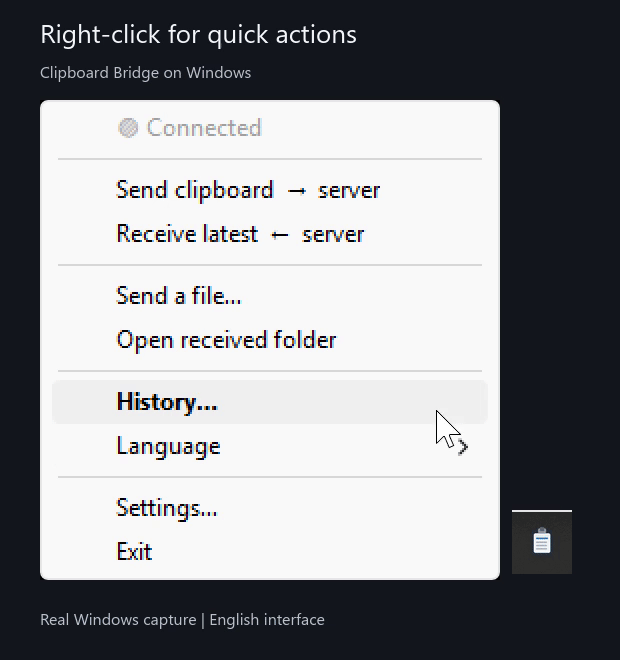

#  Clipboard Bridge

**Copy on one device. Use it on another.**

Share text, links, photos and files between **Windows, Android, iPhone and iPad**.
For example, send a photo from your phone to your PC, or copy a link on Windows
and receive it on your phone. Mac can use the same workflow through Apple Shortcuts.

Use an always-on home server for the full experience, **or let the Windows app
be the server if you do not have one**. Your devices connect through your local
network or a private VPN. A Clipboard Bridge account is optional.

No mandatory cloud service, online account, subscription or telemetry.

**On iPhone, sharing is within easy reach:** add Send and Receive to **Control
Center**, or run the Send Shortcut from another app's **Share Sheet**. Once set
up, you do not need to reopen the Shortcuts editor for each transfer.

[See the illustrated iPhone setup and quick-access tips](https://mattboxx.github.io/Clipboard-Bridge/windows-iphone-clipboard.html#iphone).

**English** | [Italiano](README.it.md)

[Website](https://mattboxx.github.io/Clipboard-Bridge/) |
[Downloads](#download) | [Desktop demo](#desktop-in-action) | [Start here](#start-here) |
[Full guide](GUIDE.md) | [Developers](#developers)

New here? Follow the [step-by-step setup tutorial](https://mattboxx.github.io/Clipboard-Bridge/tutorial.html).

Device-specific guides: [Windows to iPhone clipboard sharing](https://mattboxx.github.io/Clipboard-Bridge/windows-iphone-clipboard.html)
and [sharing a clipboard between Apple and Android devices](https://mattboxx.github.io/Clipboard-Bridge/apple-android-clipboard.html).

[](https://github.com/Mattboxx/Clipboard-Bridge/actions/workflows/validate.yml)
[](LICENSE)

## Desktop in action

**Find a previous clipboard, preview an image or PDF, and copy it again.**
The Windows app keeps search, file groups and Send/Receive together in one window.


*Real application screen with public sample data, not private clipboard contents.*

**Quick actions next to the clock.** Right-click the tray icon for Send, Receive
and History; left-click opens History directly.

<picture>
  <source media="(prefers-reduced-motion: reduce)" srcset="docs/assets/demo/windows-tray-menu.png">
  
</picture>

*Real Windows recording in English, cropped for privacy. It demonstrates the tray
controls, not a phone-to-PC transfer.* [Replay GIF](docs/assets/demo/windows-tray-menu.gif)
or [watch video](docs/assets/demo/windows-tray-menu.mp4).

**Prefer automatic sharing?** Enable **Automatic synchronization** in
**Settings > Automation** and keep the app running. Leave automatic file downloads
enabled to receive files too. Manual Send/Receive buttons remain available.
Auto-sync can also share sensitive text you copy, so enable it deliberately.

## Choose your setup

Every device connects to one place that stores the shared clipboard. Choose where it runs:

| | **Standalone server: full experience** | **Windows Server mode: no extra hardware** |
|---|---|---|
| Runs on | A NAS, home server, Raspberry Pi or Docker/Python host | The Windows app itself |
| Why choose it? | Available while your Windows PC is off | The quickest phone-to-PC setup |
| Shared text, photos, files and history | Yes | Yes |
| Web page and separate user accounts | Yes | No |
| Must stay running | Your server | Your Windows PC and the app |
| Windows setting | **Client mode** | **Server mode** |

The standalone server improves everyday use with an always-on clipboard, browser
access and isolated accounts. **It is not required:** Windows Server mode handles
the same shared content without Docker or a separate computer.

## Download

**Current releases:** Windows 2.0.15 | Android 1.0.0-beta.11 | Server 1.0.8

| Your device | Ready-to-use downloads |
|---|---|
| **Windows 10/11, Intel or AMD (x64)** | [Installer](https://github.com/Mattboxx/Clipboard-Bridge/releases/download/2.0.15/Clipboard.Bridge_windows_client_and_server_setup_x64_V2.0.15.exe) or [portable EXE](https://github.com/Mattboxx/Clipboard-Bridge/releases/download/2.0.15/Clipboard.Bridge.Portable.Windows.x64.V2.0.15.exe) |
| **Windows 11 ARM, such as Snapdragon PCs** | [Native ARM64 installer](https://github.com/Mattboxx/Clipboard-Bridge/releases/download/2.0.15/Clipboard.Bridge_windows_client_and_server_setup_arm64_V2.0.15.exe) or [native ARM64 portable EXE](https://github.com/Mattboxx/Clipboard-Bridge/releases/download/2.0.15/Clipboard.Bridge.Portable.Windows.arm64.V2.0.15.exe) |
| **Android 10 or newer** | [Android APK](https://github.com/Mattboxx/Clipboard-Bridge/releases/download/2.0.15/Clipboard.Bridge.Android.universal.V1.0.0-beta.11.apk), currently a public beta |
| **iPhone and iPad** | [Send Shortcut](https://github.com/Mattboxx/Clipboard-Bridge/releases/download/2.0.15/iPhone.Load.Clipboard.shortcut) and [Receive Shortcut](https://github.com/Mattboxx/Clipboard-Bridge/releases/download/2.0.15/iPhone.Download.Clipboard.shortcut) |
| **Mac** | [Apple Shortcuts setup guide](GUIDE.md#mac-compatibility); no native Mac app |
| **NAS or home server** | [App-store installation](https://github.com/Mattboxx/Clipboard-Bridge-AppStore#readme) or [Docker setup](#standalone-server) |

The installer is the easiest Windows option. The portable EXE needs no installation.
Both save settings and history in your user folder and preserve them across updates.
To check your processor, open **Settings > System > About > System type**. Quit the
app before switching between x64 and ARM64; both architectures share your settings.

> **Windows security:** installer and portable downloads are not digitally signed yet.
> Defender or Smart App Control may block them. Read [CODE_SIGNING.md](CODE_SIGNING.md);
> do not disable Windows protection to bypass a warning.

All assets, checksums and release notes are in the [2.0.15 release](https://github.com/Mattboxx/Clipboard-Bridge/releases/tag/2.0.15).
Image/PDF previews and native ARM64 packages are included. See [CHANGELOG.md](CHANGELOG.md)
for the full changes; Android and the standalone server have independent version numbers.

## Start here

**First, check the network:** your devices must reach the clipboard host through
the same trusted Wi-Fi/LAN or a private VPN. Mobile data alone cannot reach a home
LAN address. See [Network and security](#network-and-security) for remote use.

### Without a home server

1. Install or open the Windows app.
2. Open **Settings > General** and select **Server mode**.
3. Keep port `5088`, unless it is already in use, and allow the app through the
   Windows firewall on your private network.
4. Enter the address shown by Windows in Android and both iPhone Shortcuts.
5. Keep the PC and app running. Send from one device and receive on the other.

### With a home server

1. Install the [standalone server](#standalone-server) and open `http://SERVER_IP:5088/`.
2. Choose **Client mode** in Windows Settings and enter that server address.
3. Use the same address on Android and in both Apple Shortcuts.
4. Leave token/account fields empty for the shared clipboard, or use the same
   configured account on every device. Run **Check connection** or **Test connection**.

In Windows and Android settings, enter the **base address**, not an API endpoint.
Apple Shortcuts use the complete send/receive URLs described below.

## What gets shared

Unicode text, multiline notes, links, photos and files of any type: PDFs, Office
documents, archives, audio, video and custom extensions such as `.shortcut`.

**Copied text arrives as plain Unicode text**, even if the source app uses RTF.
Emoji, accents, tabs and line breaks are retained; fonts, colours and bold styling
are not transferred. Actual `.rtf` documents sent as files remain unchanged.
This works with server 1.0.8 or Windows Server mode 2.0.15, for every connected client.

**The latest upload always wins.** Text, images and files have equal priority.
Several files sent together stay in **one history item**; restoring or deleting it
affects the whole group. Generic clients receive groups as a transport ZIP.

History supports search, type filters and previous/next pages. Search matches text
previews and filenames, including group members, not the complete document contents.

<details>
<summary>Connection diagram: two alternative hosting modes</summary>


</details>

## Your devices

### Windows

The tray app supports manual sharing, configurable hotkeys, optional auto-sync,
image/PDF previews, local history and automatic receiving. Left-click its icon
to open History; sending is a separate action. Only one instance runs at a time.

**Quick actions, next to the clock:** right-click the tray icon to send your
clipboard, receive the latest item or open History. Left-click opens History directly.

**Windows can sync automatically:** enable **Automatic synchronization** in
**Settings > Automation** to send copied content and receive new shared items
without pressing Send or Receive each time. Keep the app running and leave
**Automatically download new files** enabled to receive files automatically too.
Only enable auto-sync if you want copied content to be shared, including sensitive text.

See the [desktop screenshots and animated tray demo](#desktop-in-action).

<details>
<summary>Windows settings, notifications and history</summary>

- **General:** choose Client/Server mode, light/dark appearance and language.
- **Connection:** set the server address and optional token/account; use
  **Check connection now** to verify the connection.
- **Automation:** configure synchronization, local recording, automatic incoming
  file downloads and separate text/image/file notifications.
- **Shortcuts:** configure global hotkeys for Send, Receive and opening History.
  History defaults to **Ctrl+Alt+H**; change it in **Settings > Shortcuts**.
  Click **Set keys...**, press and release your chosen combination, then **Save**.
  Escape cancels recording. Shortcuts pause while recording to prevent accidental transfers.
  Windows reports combinations already used by another app before settings are saved.
  Press the History hotkey once to open it and again to close it; the next press
  reopens it. Tray clicks still open or focus History. Neither action sends your clipboard.
  Invalid or duplicate shortcuts
  are rejected before saving; existing settings are preserved during upgrades.
- Received files are saved in `Downloads/Clipboard Bridge` and placed in the
  Windows clipboard. Clicking a file notification opens the received-files folder.
- Enable **Preview** in History to see the selected image or first PDF page,
  including local items and the first previewable member of a file group.
  Thumbnails load in the background without changing your clipboard or saving downloads.
- **This PC** history is private to that PC. **Server** history contains uploaded
  items, visible to the other devices. Use Send or auto-sync to publish local content.
- Clipboard changes made by an administrator-level application may not be
  detected by an ordinary Windows process. This affects **all Windows packages**;
  Clipboard Bridge may also need administrator privileges in that situation.
- The interface is available in English and Italian. Settings and data belong
  in your writable user folders, not Program Files.


</details>

### Android

Send from the clipboard, file picker or another app's **Share** menu. Receive the
latest item, browse live server history, restore an older item or delete it after
confirmation. Text and file notifications can be configured separately.

<details>
<summary>Android installation, account setup and Quick Settings</summary>

1. Open the downloaded APK, authorize installation from that browser/file manager
   if Android asks, then select **Install** or **Update**.
2. Open the gear button and enter the server base address.
3. Choose **Shared space** for the general clipboard; enter a token only if configured.
4. Choose **Account** for an existing standalone-server user and enter its credentials.
5. Run **Test connection**, save and allow notifications for incoming monitoring.

Account status must show **Connected - @USERNAME**. If histories differ between
Android and the browser, verify the selected account. Android reads the server's
history directly; it does not maintain a separate local history. The visible list
refreshes every five seconds.

**Send clipboard** uploads the current clipboard. **Receive latest** restores the
newest item. **Send file** and the Share menu accept one or several files, keeping
a multiple selection together. Share uploads close without leaving the main app open.
Received files are saved in `Downloads/Clipboard Bridge`; Android uses content URIs
for file clipboard entries, so pasting depends on the destination app's support.

Add **Send clipboard** and **Receive clipboard** through **Quick Settings > Edit**.
The tiles use a brief transparent helper for clipboard access and return to your
previous screen instead of opening the main interface.

**Background limits:** Android 10+ restricts continuous background clipboard reads.
Outgoing auto-send works while Clipboard Bridge is visible; Share and the Send tile
are the alternatives in other apps. Optional incoming monitoring uses a foreground
service and notification; use Receive for reliable clipboard placement. Manufacturer
battery restrictions may require allowing background activity and excluding the app
from battery optimization. Notifications for received text, files and sent items are
separately configurable. The interface is English/Italian.

Updates signed with the same project key preserve the configuration.
[Android documentation and build instructions](android/README.md).

</details>

### iPhone and iPad

Use two Shortcuts for every content type: **Load Clipboard** sends and
**Download Clipboard** receives. Add both to the iPhone Control Center for quick access.

<details>
<summary>Shortcut URLs, accounts, photos and multiple files</summary>

Replace `SERVER_IP` with your host's address; use its configured port if not `5088`.

| Shortcut | Request | Shared-space URL |
|---|---|---|
| Load Clipboard | `POST` | `http://SERVER_IP:5088/clipboard` |
| Download Clipboard | `GET` | `http://SERVER_IP:5088/clipboard/latest/raw` |

For an isolated account, append the URL-encoded credentials to **both** URLs:

```text
http://SERVER_IP:5088/clipboard?user=alice&password=YOUR_ENCODED_PASSWORD
http://SERVER_IP:5088/clipboard/latest/raw?user=alice&password=YOUR_ENCODED_PASSWORD
```

For a protected shared space, use `?token=YOUR_TOKEN` instead. With no protection
configured, use the plain URLs. **Token and account are optional; URL credentials
are in plain text.** The web login uses the same account; an empty username selects
the general clipboard.

Enable **Show in Share Sheet** to send from Photos, Files and other apps. For the
Control Center, add a **Shortcut** control, select Load Clipboard, and add a second
one for Download Clipboard.

**For grouped files and uncommon extensions, apply the actions in the
[complete Shortcut guide](GUIDE.md#51-send-clipboard-to-server) after importing the
signed downloads.** They cannot be rewritten/re-signed on Windows:

- A single non-text file includes its URL-encoded `filename`, preserving `.shortcut`
  and other extensions even with a generic MIME type. Text does not use this parameter.
- Several files are packed into a temporary ZIP and posted to `/clipboard/bundle`;
  the server stores the members together, not as an ordinary ZIP attachment.
- Receiving checks `/clipboard/latest/meta`, extracts a group when required and
  copies its members together. The content-type choice is automatic.
- A ZIP deliberately sent to the normal `/clipboard` endpoint remains a ZIP file.
- If the URL already has credentials, append parameters with `&`, not another `?`.

[Shortcut notes](Iphone%20Shortcuts/README.md) and [full setup guide](GUIDE.md).

</details>

### Mac

Use the manual send/receive workflow in Apple Shortcuts, optionally with a keyboard
shortcut. **There is no native Mac client or continuous background sync.** The
distributed iPhone files have not been device-tested on a Mac; build the same
actions if importing fails. See [Mac compatibility](GUIDE.md#mac-compatibility).

## Standalone server

**Stable Docker image:** `ghcr.io/mattboxx/clipboard-bridge-server:1.0.8`

Supports Linux `amd64` and `arm64`. The service listens on `5088`, stores persistent
data in `/data`, and needs no separate database. The web page supports text/file
uploads, searchable history, downloads, refresh, deletion and optional login.

**App stores:** follow [Clipboard Bridge App Store](https://github.com/Mattboxx/Clipboard-Bridge-AppStore#readme)
for ZimaOS, Portainer, Umbrel, Runtipi and Dockge. For ZimaOS, add this permanent
**JSON v2 source**, not a repository ZIP:

```text
https://mattboxx.github.io/Clipboard-Bridge-AppStore/store.json
```

<details>
<summary>Install and update with Docker Compose</summary>

```bash
git clone https://github.com/Mattboxx/Clipboard-Bridge.git
cd Clipboard-Bridge
cp .env.example .env
docker compose up -d
```

On PowerShell, use `Copy-Item .env.example .env` instead of `cp`. Edit `.env` first
to choose credentials, data storage and the image tag. For a pinned deployment,
set `APP_IMAGE=ghcr.io/mattboxx/clipboard-bridge-server:1.0.8`; otherwise the example
uses the latest stable image. Compose uses the published image, not a source build.

Open `http://SERVER_IP:5088/` from another device, or `http://localhost:5088/` on
the host. The default persistent host folder is `./data`.

```bash
docker compose pull
docker compose up -d
docker compose ps
```

Back up the data directory with the service stopped. Do not remove its volume when
updating. Image tags: `latest` is stable, `1.0.8` pins a release, `edge` tracks tested
main-branch builds. See [DOCKER.md](DOCKER.md) for deployment and backup details.

</details>

## Network and security

- Devices need the **same trusted local network or a private VPN**, for either server mode.
- **Away from home or on untrusted Wi-Fi, we recommend [Tailscale](https://tailscale.com/).**
  Install it on the clipboard host and your devices, join the same private Tailscale
  network and use the host's Tailscale address in every client and Apple Shortcut.
  It works with Docker/Python hosting and **Windows Server mode**. Tailscale is
  optional; another private VPN can work too, and a trusted LAN needs no VPN.
- To keep the **same LAN IP and port at home and away**, configure an always-on
  home server/NAS as a subnet router. Advertise and approve the LAN route, allow access
  and reserve the host's IP. Clipboard Bridge does not configure routing automatically.
- **Accounts and tokens are optional.** The general clipboard stays available when
  users are added. Use protection when untrusted people can reach the network.
- `user`, `password` and `token` parameters are visible in URLs. Plain HTTP does
  not encrypt them; a VPN does not encrypt every possible LAN hop either.
- Do not expose port `5088` directly to the internet. Use a trusted LAN, private VPN
  or an HTTPS reverse proxy. A web password is not a substitute for API protection.

[Network, VPN and subnet-routing guide](GUIDE.md#local-network-vpn-and-subnet-routing) |
[Security policy](SECURITY.md)

## Developers

The repository contains the complete sources, dependencies, tests and packaging.
Browse the [server source](https://github.com/Mattboxx/Clipboard-Bridge/blob/main/clipboard_bridge-Server.py)
and [Windows client source](https://github.com/Mattboxx/Clipboard-Bridge/blob/main/clipboard_bridge_windows.py)
in the repository. Release downloads contain ready-to-use apps and iPhone Shortcuts,
not standalone Python scripts. Clone the repository for development or running from source.

### Run from source

Use Python 3.12 for the server and x64 Windows client; native Windows ARM64 builds
use ARM64 Python 3.13. Prefer an isolated virtual environment.

```bash
python -m venv .venv
# Activate .venv for your shell, then:
python -m pip install -r requirements-server.txt
python clipboard_bridge-Server.py
```

On Windows, install `requirements-client.txt` and run `python clipboard_bridge_windows.py`.
The client uses Tkinter/pystray; clipboard images and files use Windows APIs through
ctypes. Image/PDF previews use Pillow and pypdfium2/PDFium. See [third-party notices](THIRD_PARTY_NOTICES.md).
The standalone server uses Flask. Its Docker image uses one Gunicorn worker with
threads: do not add independent workers against the same JSON data store.

### Server configuration

| Python environment variable | Default | Purpose |
|---|---|---|
| `CLIPBOARD_PORT` | `5088` | Listening port |
| `CLIPBOARD_TOKEN` | empty | Optional shared API token |
| `CLIPBOARD_PASSWORD` | empty | Optional shared web-login password |
| `CLIPBOARD_ACCOUNTS` | empty | Comma-separated `user:password` accounts |
| `CLIPBOARD_ACCOUNTS_FILE` | empty | One `user:password` per line in a file |
| `CLIPBOARD_SESSION_DAYS` | `3650` | Remembered web login, 1..3650 days; use 90/365 for a shorter session |
| `CLIPBOARD_MAX_HISTORY` | `200` | Retained entries per clipboard space |
| `CLIPBOARD_MAX_UPLOAD_MB` | `64` | Maximum request/upload size in MB |
| `CLIPBOARD_DATA_DIR` | `./clipboard_data` | Persistent data directory |

In Compose, edit the shorter variables in `.env`: `APP_PORT`, `DATA_ROOT`,
`APP_IMAGE`, `API_TOKEN`, `WEB_PASSWORD`, `ACCOUNTS`, `ACCOUNTS_FILE`, `MAX_HISTORY`
and `MAX_UPLOAD_MB`. They map to the container settings; `/data` is the container's
storage path. Mount account files and use their **container path**.

Accounts have isolated files and histories with **no fixed account-count limit**;
practical limits depend on host resources. Prefer `CLIPBOARD_ACCOUNTS_FILE` for many
users. The shared space remains available. Web login remembers the selected account
in a long-lived session; logout or cleared browser cookies ends that device session.

### API reference

<details>
<summary>Endpoints, authentication, payloads and history pagination</summary>

The table describes the standalone server. Windows Server mode implements the
shared clipboard workflow, without the standalone web login or isolated accounts.

| Method | Endpoint | Purpose |
|---|---|---|
| `POST` | `/clipboard` | Universal text, image, file or multipart group upload |
| `POST` | `/clipboard/bundle` | A ZIP used specifically as a grouped-file transport |
| `GET` | `/clipboard/latest` | Latest item, including text or Base64 binary content |
| `GET` | `/clipboard/latest/meta` | Latest metadata without downloading the content |
| `GET` | `/clipboard/latest/raw` | Latest raw text/file, or transport ZIP for a group |
| `GET` | `/clipboard/history` | Metadata list, search, filtering and pagination |
| `DELETE` | `/clipboard/history` | Clear the selected space's history and stored files |
| `GET`, `DELETE` | `/clipboard/item/<id>` | Read or delete one item/group in the selected space |
| `GET` | `/clipboard/item/<id>/raw` | Download an exact item/group |
| `GET` | `/clipboard/item/<id>/file/<index>/raw` | Download one group member by zero-based index |
| `GET` | `/health` | Public service status and version |
| `GET`, `POST` | `/login` | Standalone web login |
| `GET` | `/logout` | End the browser session |

Legacy endpoints remain supported: `/1` for upload, `/clipboard/raw` for raw receiving,
plus `/clipboard/text`, `/clipboard/text/raw`, `/clipboard/image`,
`/clipboard/image/latest`, `/clipboard/image/latest/raw`, `/clipboard/file` and
`/clipboard/file/latest`. New integrations should use the universal endpoints.

**Authentication:** optional `?token=...` or `X-Auth-Token` for the shared API;
`?user=...&password=...` or `X-Clipboard-User`/`X-Clipboard-Password` for an account.
Apply credentials to uploads, metadata, history, member downloads and deletion,
not just receiving. URL-encode parameter values; append further parameters with `&`.
`CLIPBOARD_PASSWORD` protects the shared web page; it does not enable API-token
protection by itself. Browser sessions can authenticate browser requests.

Native clients and Apple Shortcuts retain compatible account URLs. Header
authentication remains an optional API alternative, not a new requirement.
No extra login, pairing or refresh token is introduced. **Neither headers nor
URL encoding encrypt credentials over plain HTTP.**

**Payloads:** raw text/binary, multipart files and JSON/Base64 are accepted. Set
the original filename via multipart or `filename`/supported filename headers when
MIME alone is ambiguous. Raw replies expose `X-Clipboard-Id`, `X-Clipboard-Type`
and, for files, filename metadata. A normal uploaded ZIP stays a file;
`/clipboard/bundle` explicitly requests group extraction.

```bash
curl -X POST http://localhost:5088/clipboard \
  -H 'Content-Type: text/plain; charset=utf-8' --data-binary 'Hello from another device'
curl -X POST http://localhost:5088/clipboard \
  -F 'files=@report.pdf' -F 'files=@photo.jpg'
curl http://localhost:5088/clipboard/latest/raw
```

These Bash examples use an open shared space. Add authentication if configured.

**History search:** `GET /clipboard/history?q=report&type=file&limit=30&offset=0`.
Types are `text`, `image`, `file`, `bundle`; omit `type` for all. Search examines
previews and filenames, not full documents. `limit` is 1-1000, `offset` is nonnegative,
and `q` is at most 200 characters. The response includes `items`, `count`, `total`,
`offset`, `has_more`; `count` is the returned page size, `total` the matching count.

**Errors:** invalid input `400`, failed authentication `401`, missing item `404`,
oversized request `413`. Latest metadata returns `{"type":"empty"}` for an empty
space; latest raw content is an empty response. Retention limits remove old entries.

</details>

### Build and test

| Task | Command or documentation |
|---|---|
| Server/metadata tests | Install `requirements-server.txt` and `pytest`, then `python -m pytest -q tests/test_server.py tests/test_clipboard_text.py tests/test_clipboard_storage.py tests/test_release_metadata.py` |
| Windows tests | Install `requirements-client.txt` and `pytest`, then `python -m pytest -q tests/test_windows_client.py tests/test_clipboard_text.py tests/test_clipboard_storage.py` on Windows |
| Version consistency | `python scripts/release_metadata.py --check` |
| Windows x64 packaging | `scripts\windows\build_release.bat 2.0.15`; requires x64 Python, PyInstaller and Inno Setup |
| Windows ARM64 packaging | **Build Windows ARM64** Actions workflow; native runner, tests, payload and installer verification |
| Android build | Java 17, Android SDK 35; [Gradle and private signing instructions](android/README.md#build-from-source) |
| Docker source build | `docker build -t clipboard-bridge-server:dev .` |

`VERSION` drives Windows release metadata. Keep sources, downloads and docs in sync.
Never commit credentials, clipboard data, Android signing keys or local build output.
[CONTRIBUTING.md](CONTRIBUTING.md) covers setup, validation and ARM64 artifact publication;
[CODE_SIGNING.md](CODE_SIGNING.md) explains Windows signing and release checksums.

### Repository map

| Path | Purpose |
|---|---|
| `clipboard_bridge_windows.py` | Windows client and built-in server |
| `clipboard_bridge-Server.py` | Standalone Flask server and web interface |
| `clipboard_text.py` | Shared Unicode/RTF conversion; keep alongside either Python script |
| `clipboard_storage.py` | Shared fail-safe history reads and atomic index writes; keep alongside either Python script |
| `android/` | Android source and build files |
| `Iphone Shortcuts/` | Signed Shortcut exports and update instructions |
| `Dockerfile`, `compose.yaml`, `docker-compose.yml`, `.env.example` | Container deployment |
| `requirements-*.txt` | Python dependencies |
| `scripts/` | Development, validation and Windows build commands |
| `packaging/windows/` | Inno Setup installer and generated Windows version metadata |
| `tests/` | Regression tests |
| `.github/workflows/` | Validation, native ARM64 build, images and website deployment |
| `docs/` | GitHub Pages source and public sample screenshots |
| `docs/development/` | Architecture, component boundaries and developer documentation |
| `maintainer/` | Release checklists, manual validation and media provenance |
| `distribution/` | Store adapters; the separate AppStore repository publishes the catalogs |

[Architecture and repository layout](docs/development/ARCHITECTURE.md) |
[Script commands](scripts/README.md) | [Windows packaging](packaging/windows/README.md)

[Quality audit and remaining verification gates](maintainer/QUALITY_PLAN.md) |
[Backup and recovery](DOCKER.md#history-storage-errors)

[Full user guide](GUIDE.md) | [Docker guide](DOCKER.md) | [Android documentation](android/README.md) |
[Changelog](CHANGELOG.md) | [Security](SECURITY.md)

Released under the [MIT License](LICENSE). Dependency licenses are described in
[THIRD_PARTY_NOTICES.md](THIRD_PARTY_NOTICES.md).

## Support the project

If Clipboard Bridge makes sharing between your devices easier, a donation helps
keep the project maintained and updated. Using it is free; support is entirely optional.
Thank you for choosing to contribute!

[**Support Clipboard Bridge on Ko-fi**](https://ko-fi.com/mattboxx)
