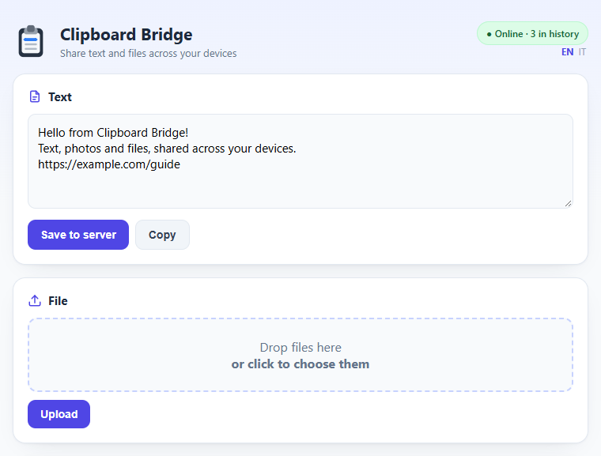
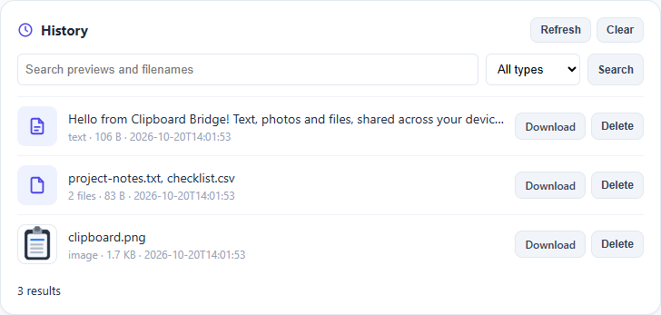

# Clipboard Bridge

Share text, photos and files across Windows, Android and Apple Shortcuts through
your home server. The web interface includes persistent history, grouped uploads
and optional isolated accounts. No mandatory cloud account is required.

This is a companion utility for a home-server installation, **not** a Home Assistant
integration, MQTT broker, device controller or IoT discovery service.

## Install and connect

1. Review the optional authentication settings before installing. Empty values
   leave the general shared clipboard open on the reachable network.
2. Open `http://YOUR_SERVER_IP:5088/` on a trusted LAN/private VPN. `/health`
   checks basic reachability. Do not expose this port directly to the internet.
3. Windows: choose Client mode and this base address. Android: use the same base
   address and space/account. Apple Shortcuts: POST to `/clipboard`, GET from
   `/clipboard/latest/raw`, with the same optional credentials on both.
4. Preserve `/DATA/AppData/clipboard-bridge/data` across updates and make backups.
   Avoid using a data directory that belongs to an already running installation.

General browser password and API token are separate protections. Account/token
URL values are readable and HTTP is not encrypted. Do not include real credentials
in a PR, issue, screenshot or shared configuration.

[Homepage](https://mattboxx.github.io/Clipboard-Bridge/) |
[Docker installation](https://github.com/Mattboxx/Clipboard-Bridge/blob/main/DOCKER.md) |
[Device instructions](https://github.com/Mattboxx/Clipboard-Bridge/blob/main/GUIDE.md) |
[Issues](https://github.com/Mattboxx/Clipboard-Bridge/issues)
